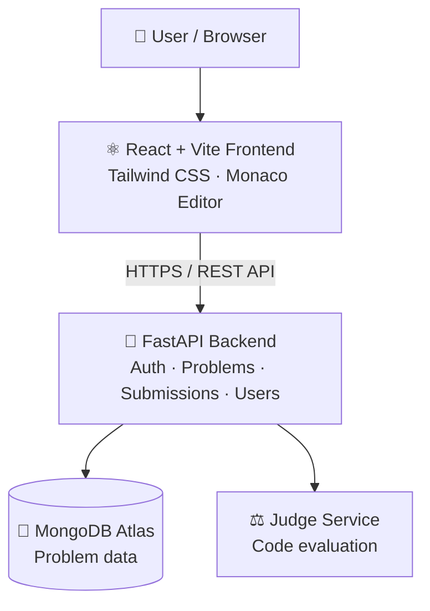

<div align="center">

<h1>🧩 AlgoNest</h1>

<h3>Practice. Solve. Grow.</h3>

<p>
A full-stack coding practice platform where developers can explore algorithm problems,<br/>
write code in the browser, and evaluate solutions with an automated judging workflow.
</p>

<p>
  <a href="https://algonest-platform.netlify.app/"></a>
  <a href="https://algonest-293u.onrender.com/docs"></a>
  <a href="https://github.com/vs99230/AlgoNest"></a>
</p>

<p>
  
  
  
  
  
  
  
</p>

<p>
  <a href="#-overview">Overview</a> •
  <a href="#-features">Features</a> •
  <a href="#-tech-stack">Tech Stack</a> •
  <a href="#-architecture">Architecture</a> •
  <a href="#-getting-started">Getting Started</a> •
  <a href="#-deployment">Deployment</a> •
  <a href="#-contributing">Contributing</a>
</p>

</div>

---

## 📖 Overview

**AlgoNest** is a LeetCode-inspired coding practice platform that makes algorithm practice accessible through a single web application. Users can browse coding problems, read problem statements, write solutions in the editor, and submit code for evaluation.

The project includes a **React** frontend, a **Python FastAPI** backend, **MongoDB** for persistent problem data, and an **online code-judging integration**. It is deployed publicly, with automated CI checks for backend tests and frontend builds.

---

## ✨ Features

| | Feature | Description |
|---|---|---|
| 📚 | **Problem Library** | Browse a curated collection of coding problems |
| 📝 | **Problem Details** | Descriptions, examples, constraints, difficulty, and topic tags |
| 💻 | **Code Editor** | Write and edit solutions in the browser (Monaco Editor) |
| ⚡ | **Code Execution & Judging** | Run or submit solutions through the connected judging workflow |
| ✅ | **Test-Case Evaluation** | Check solutions against examples and hidden test cases |
| 🔐 | **User Accounts** | Authentication-related frontend and backend modules |
| 🏆 | **Progress Pages** | Profile, submissions, leaderboard, and contests areas |
| 🗄️ | **Persistent Data** | Problem records served from MongoDB |
| 🔌 | **REST API** | Frontend and backend communicate via JSON endpoints |
| 🤖 | **Automated Checks** | GitHub Actions runs backend tests and verifies the frontend build |
| 🌍 | **Live Deployment** | Public frontend and backend deployments |

> [!NOTE]
> Availability of individual pages or features may depend on the current deployment configuration.

<!--
📸 SCREENSHOTS (uncomment after adding images to a /docs/screenshots folder)

## 📸 Screenshots

<div align="center">
  
  
</div>
-->

---

## 🔗 Live Links

| Resource | Link |
|---|---|
| 🌐 Frontend application | [algonest-platform.netlify.app](https://algonest-platform.netlify.app/) |
| ⚙️ Backend service | [algonest-293u.onrender.com](https://algonest-293u.onrender.com/) |
| 📘 Interactive API docs | [algonest-293u.onrender.com/docs](https://algonest-293u.onrender.com/docs) |
| 📋 Problems API | [/api/problems](https://algonest-293u.onrender.com/api/problems) |
| 💾 Source code | [github.com/vs99230/AlgoNest](https://github.com/vs99230/AlgoNest) |

---

## 🛠️ Tech Stack

| Layer | Technologies |
|---|---|
| **Frontend** | React, Vite, Tailwind CSS, Monaco Editor |
| **Backend** | Python, FastAPI, Uvicorn |
| **Database** | MongoDB Atlas |
| **Code Judging** | Judge0-compatible judging integration / configured judge service |
| **API** | REST, JSON |
| **Testing** | pytest, frontend production build |
| **CI** | GitHub Actions |
| **Deployment** | Netlify (frontend), Render (backend) |
| **Version Control** | Git & GitHub |

---

## 🏗️ Architecture



### Request Flow

1. A user opens AlgoNest and selects a problem.
2. The frontend requests problem data from the FastAPI backend.
3. The backend reads the problem information from MongoDB.
4. The user writes a solution and submits it.
5. The backend sends the code to the configured judging service.
6. The result is returned to the frontend for display.

---

## 📁 Repository Structure

```text
AlgoNest/
├── .github/
│   └── workflows/
│       └── ci.yml            # CI: backend tests + frontend build
├── backend/
│   ├── app/
│   │   ├── core/             # Config & shared utilities
│   │   ├── routers/          # API route modules
│   │   └── main.py           # FastAPI entry point
│   ├── tests/                # pytest test suite
│   ├── requirements.txt
│   ├── seed_db.py            # Database seed script
│   └── .env.example
├── frontend/
│   ├── src/
│   ├── public/
│   ├── package.json
│   └── vite.config.js
├── .gitignore
└── README.md
```

> The tree highlights the main areas of the project; individual files may vary as the application evolves.

---

## 🚀 Getting Started

### Prerequisites

- **Python** 3.11 or a compatible supported version
- **Node.js** and **npm**
- A **MongoDB** database (MongoDB Atlas or a local instance)
- Credentials for the code-judging provider, if required

### 1. Clone the repository

```bash
git clone https://github.com/vs99230/AlgoNest.git
cd AlgoNest
```

### 2. Set up the backend

```bash
cd backend
python -m venv venv
```

Activate the virtual environment:

<details>
<summary><b>Windows (PowerShell)</b></summary>

```powershell
.\venv\Scripts\Activate.ps1
```

</details>

<details>
<summary><b>macOS / Linux</b></summary>

```bash
source venv/bin/activate
```

</details>

Install dependencies and create your `.env`:

```bash
pip install -r requirements.txt
```

<details>
<summary><b>Windows (PowerShell)</b></summary>

```powershell
Copy-Item .env.example .env
```

</details>

<details>
<summary><b>macOS / Linux</b></summary>

```bash
cp .env.example .env
```

</details>

Update the values in `backend/.env`:

```env
MONGODB_URI=your_mongodb_connection_string
MONGODB_DB_NAME=algonest
JWT_SECRET=replace_with_a_long_random_secret
JWT_ALGORITHM=HS256
JWT_EXPIRES_MINUTES=10080
CORS_ORIGINS=http://localhost:5173,http://localhost:4173
JUDGE0_API_URL=https://ce.judge0.com
JUDGE0_API_KEY=
JUDGE0_API_HOST=
```

> [!WARNING]
> Keep `.env` private. Never commit database credentials, JWT secrets, or judging-provider API keys.

Start the backend from the `backend` directory:

```bash
uvicorn app.main:app --reload
```

The API runs at **http://127.0.0.1:8000** — open **http://127.0.0.1:8000/docs** to explore it.

### 3. Set up the frontend

In a second terminal, from the repository root:

```bash
cd frontend
npm install
```

Create `frontend/.env`:

```env
VITE_API_URL=http://127.0.0.1:8000/api
VITE_USE_MOCK=false
```

Start the dev server:

```bash
npm run dev
```

Open the URL printed by Vite (typically **http://localhost:5173**).

> [!IMPORTANT]
> Vite exposes variables prefixed with `VITE_` to browser code. Never put private API keys or database credentials in frontend environment variables.

---

## ⚙️ Environment Variables

### Backend

| Variable | Purpose |
|---|---|
| `MONGODB_URI` | MongoDB connection string |
| `MONGODB_DB_NAME` | Database name (currently `algonest`) |
| `JWT_SECRET` | Secret used for signing JWTs |
| `JWT_ALGORITHM` | JWT signing algorithm |
| `JWT_EXPIRES_MINUTES` | Token expiry duration in minutes |
| `CORS_ORIGINS` | Comma-separated list of allowed frontend origins |
| `JUDGE0_API_URL` | Base URL of the configured judging service |
| `JUDGE0_API_KEY` | Optional provider API key, if required |
| `JUDGE0_API_HOST` | Optional provider host value, if required |

### Frontend

| Variable | Purpose |
|---|---|
| `VITE_API_URL` | Backend API base URL, including `/api` |
| `VITE_USE_MOCK` | Enables or disables mock data mode |

For production, set these values in your hosting provider's environment-variable settings.

---

## 📡 API

The backend exposes a REST API. The full, current list of routes and schemas is available in the interactive documentation:

👉 **[API Documentation](https://algonest-293u.onrender.com/docs)** — the source of truth for request bodies, response schemas, authentication requirements, and additional routes.

| Method | Endpoint | Purpose |
|---|---|---|
| `GET` | `/api/problems` | Returns the available problem list |

---

## 🧪 Testing

**Backend tests** — from the `backend` directory with the virtual environment activated:

```bash
python -m pytest -v
```

**Frontend production build** — from the `frontend` directory:

```bash
npm run build
```

**Continuous integration** — the GitHub Actions workflow in `.github/workflows/ci.yml` runs backend tests and checks that the frontend production build completes on the configured GitHub events.

---

## ☁️ Deployment

AlgoNest is deployed as separate services:

| Service | Platform |
|---|---|
| Frontend | Netlify |
| Backend | Render |
| Database | MongoDB Atlas |

**When deploying or changing domains:**

1. Set the frontend's `VITE_API_URL` to the deployed backend API base URL.
2. Set `CORS_ORIGINS` on the backend to include the exact frontend origin(s).
3. Add all backend secrets in the backend hosting provider's environment settings.
4. Redeploy after changing environment variables.
5. Verify `/docs` and `/api/problems`, then test problem loading and code submissions on the live frontend.

---

## ➕ Adding More Problems

AlgoNest can be extended with additional problem records as long as the database schema and API expectations are preserved. Each problem should include:

- A unique ID and slug
- Title and difficulty
- Problem statement, examples, and constraints
- Topic tags
- Starter code / language templates, if used
- Public examples and hidden test cases in the format expected by the judging workflow

Add new records through a safe, deliberate database update or migration process.

> [!CAUTION]
> Review `seed_db.py` before running it against any existing database — seed scripts can replace or remove records that are not in the seed dataset. Never run destructive seed operations against production without a backup and an explicit review.

---

## 🔒 Security Notes

- Keep `.env` files and production credentials out of Git.
- Use a strong, unique `JWT_SECRET`.
- Restrict MongoDB network access to trusted addresses where possible; avoid broad public access in production.
- Configure CORS with only the frontend origins that need access.
- Never expose judging-provider keys in frontend code.
- Do not run untrusted code on your own machine or server outside the intended, isolated judging workflow.

---

## 📊 Current Project Status

- ✅ Public frontend and backend deployments are available
- ✅ Problem data is served from MongoDB
- ✅ Backend tests and frontend build have been checked
- ✅ Code-judging workflow tested with example and hidden test cases

---

## 🤝 Contributing

Contributions, bug reports, and suggestions are welcome!

1. **Fork** the repository
2. **Create** a feature branch: `git checkout -b feat/your-change`
3. **Make** and test your changes
4. **Commit** your work: `git commit -m "Describe your change"`
5. **Push** the branch and open a **Pull Request**

---

## 📄 License

No license has been specified yet. Unless a license is added to this repository, default copyright rules apply and reuse is not automatically permitted.

---

<div align="center">

**Built with ❤️ for developers who love solving problems.**

<a href="https://algonest-platform.netlify.app/">Live Demo</a> •
<a href="https://github.com/vs99230/AlgoNest">GitHub</a> •
<a href="https://algonest-293u.onrender.com/docs">API Docs</a>

⭐ If you like this project, consider giving it a star!

</div>
